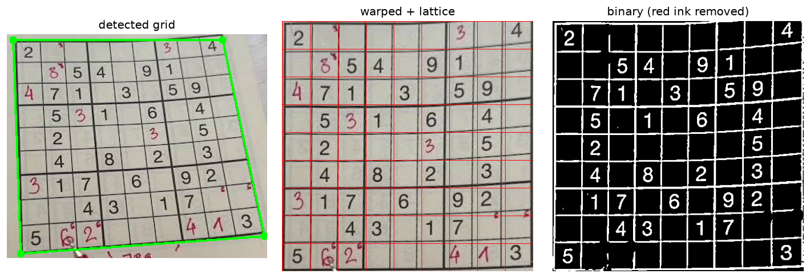
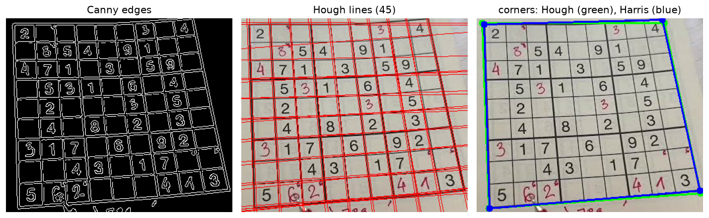
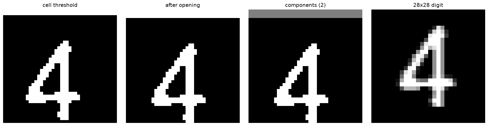
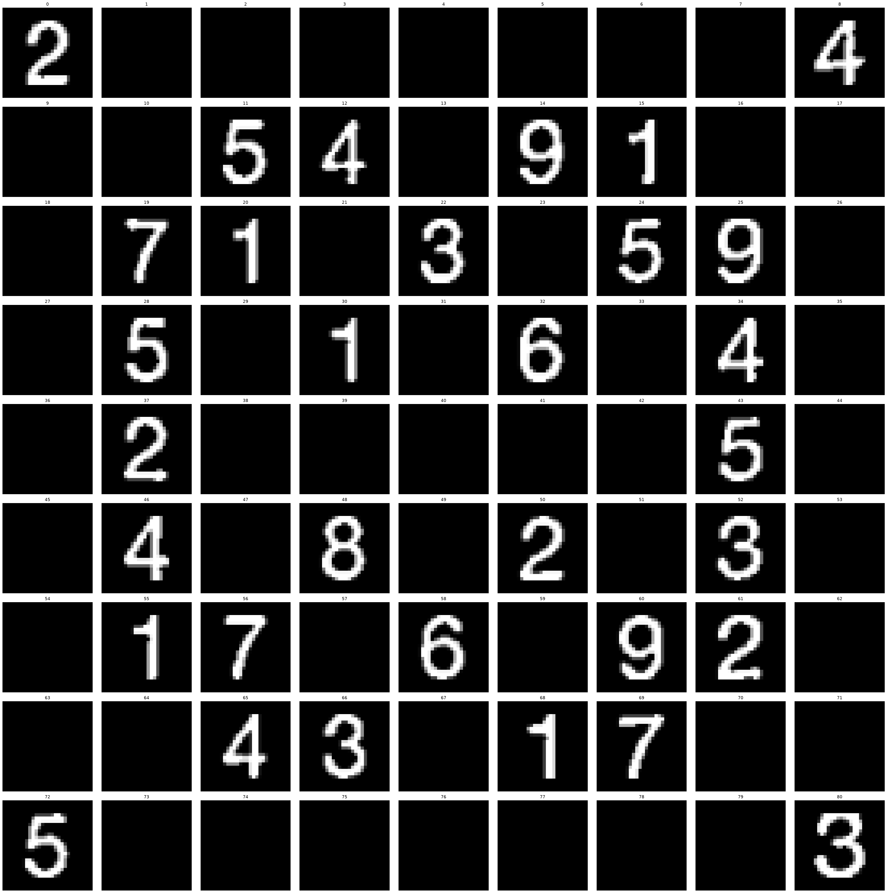
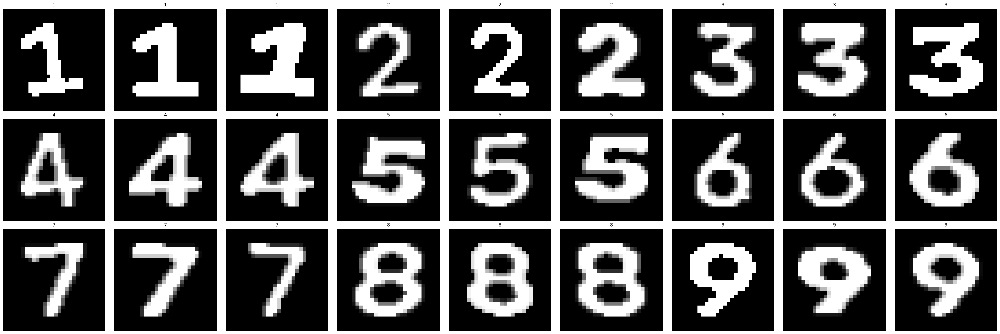

# Photo Sudoku Reader

CSCE 4603 course project. Reads a printed Sudoku from a phone photo, solves it and draws the answer back on the photo.

The full project plan is in [report/project_plan.pdf](report/project_plan.pdf).

## Setup

Uses the course venv (`../.venv`) with OpenCV, NumPy, Matplotlib and scikit-learn.

## Layout

- `data/photos/` puzzle photos (`puzzleNN.jpeg`)
- `data/ground_truth/` one text file per puzzle, 9 lines of 9 digits, `0` for empty (only printed givens, not pen marks)
- `report/` project plan and figures used in this README
- `results/` figures produced by the scripts (not committed)

## Running

Run from this folder with the course venv, e.g. `../.venv/bin/python run_checkpoint.py`.

- `preprocess.py` step 1, adaptive vs global vs Otsu threshold
- `grid.py` step 2, outer grid corners (Hough, Harris check, contour fallback)
- `warp.py` step 3, perspective warp and 81 cells
- `cells.py` step 4, cell cleaning, empty detection, 28x28 digit crops
- `synth_digits.py` generates `data/synthetic/digits.npz` (4500 digits 1-9)
- `run_checkpoint.py` runs steps 1-4 on every photo in `data/photos/`

## Progress so far

### Step 1: threshold

Gaussian blur then adaptive threshold (block 15, C 8). Global and Otsu are shown for comparison. Adaptive keeps the thin lines even where the page is darker.

### Step 2: find the grid

Canny edges and Hough lines, then the outermost horizontal and vertical lines are intersected to get the four corners. Harris corners are used as a check (about 4 px from the Hough corners on average).

### Step 3: warp and split

The corners are warped to a 450x450 square and cut into 81 cells. The inverse homography is kept for drawing the answer later.

### Step 4: cells and digits

Each cell is cleaned with an opening, then connected components decide if it is empty. Red pen marks are removed by colour so only printed digits are kept. On puzzle01 all 81 cells are marked empty or filled correctly.

### Synthetic digits

Digits 1-9 drawn with OpenCV fonts, then rotated, sheared, blurred and noised, and passed through the same step 4 code.

## Next

- more puzzle photos and ground truth files
- step 5: KNN, SVM and a small neural network, with and without PCA
- step 6: backtracking solver and drawing the answer on the photo
