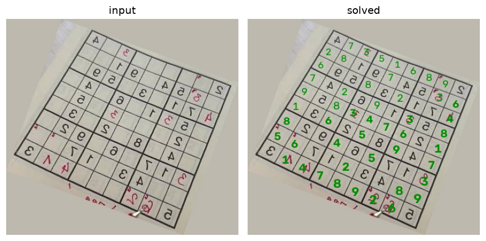
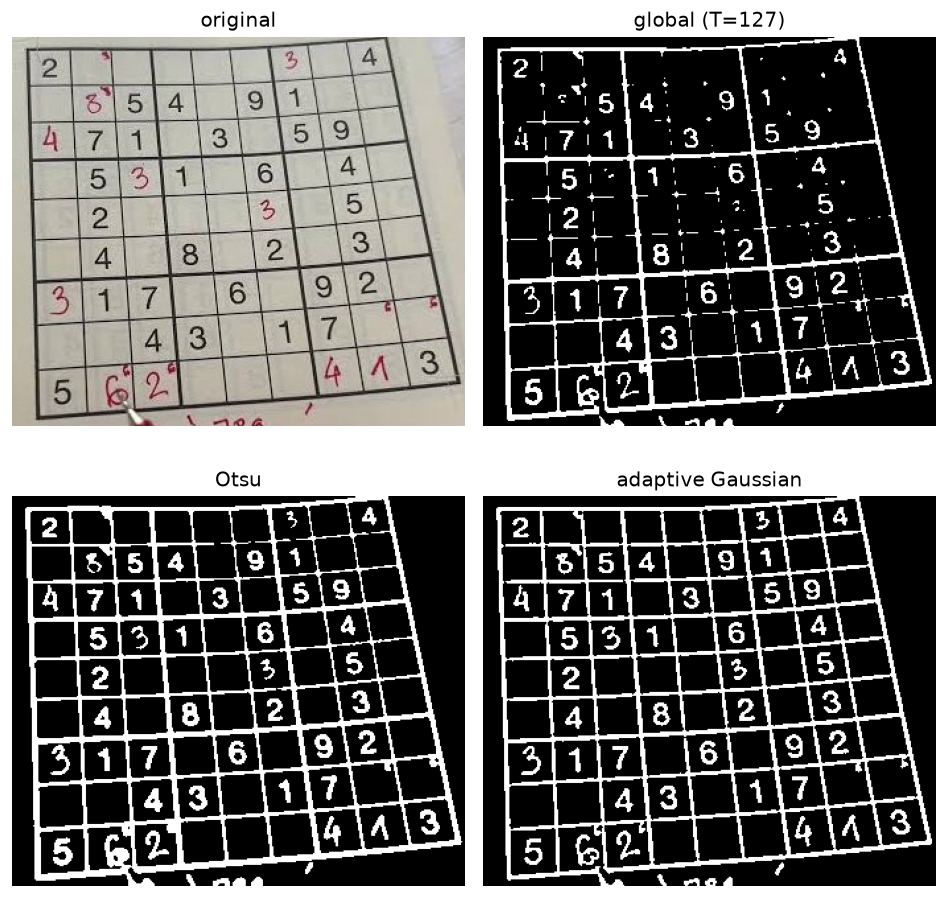
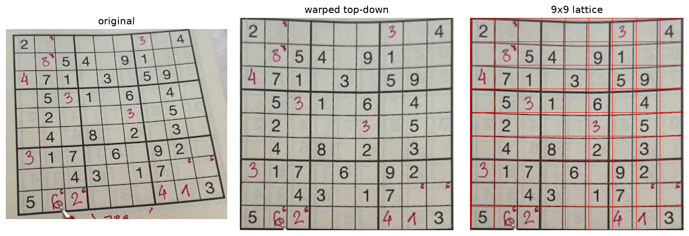
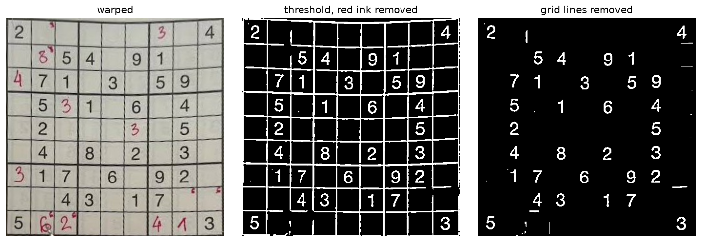
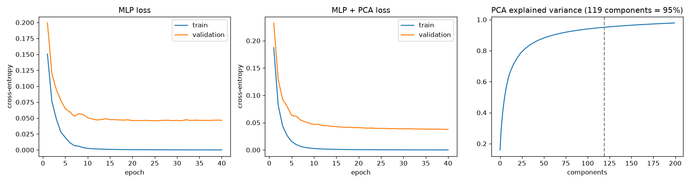
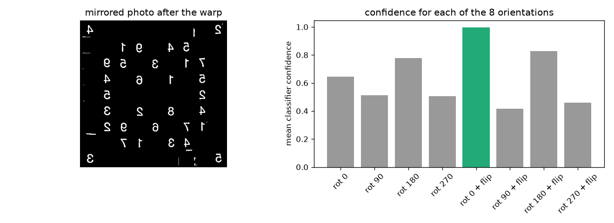
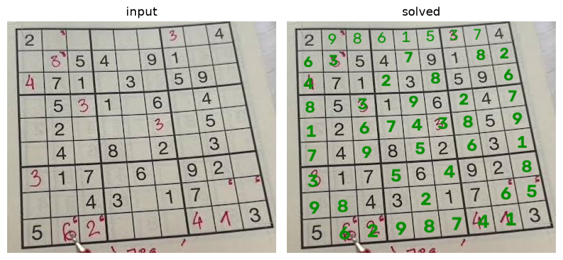

# Photo Sudoku Reader

CSCE 4603 course project. Reads a printed Sudoku from a phone photo, solves it and draws the answer back on the photo.

- Report: [report/Project_Report.pdf](report/Project_Report.pdf) (source: `report/report.html`)
- Project plan: [report/project_plan.pdf](report/project_plan.pdf)
- Dataset description: [data/README.md](data/README.md)



## Results

| | |
|---|---|
| Grid detection | 18/18 photos, mean corner error 0.08 cells |
| Empty / filled cells | 1458/1458 |
| Digit accuracy (KNN, SVM, MLP, each with and without PCA) | 576/576 real test digits for all six, validation 0.986 to 0.995 |
| Puzzles solved end to end | 18/18 |

All 18 photos come from one printed puzzle (the original plus rotated and flipped copies), so these numbers show the pipeline handles rotation and mirroring but say little about new puzzles. See the report for details.

## Setup and running

Uses the course venv (`../.venv`) with OpenCV, NumPy, Matplotlib, scikit-learn and Pillow.

```
python main.py                      # everything: figures, training, evaluation, failure cases, solved photos
python reader.py path/to/photo.jpeg # solve one photo
python make_dataset_zip.py          # sudoku_dataset.zip for the submission
```

Figures and text results go to `results/`, trained models to `models/` (both not committed).

## Files

| File | What it does |
|---|---|
| `preprocess.py` | step 1: blur and adaptive threshold (compared with global and Otsu) |
| `grid.py` | step 2: grid corners from the largest contour, Hough fallback, Harris check |
| `warp.py` | step 3: perspective warp to 450x450 and 81 cells |
| `cells.py` | step 4: grid line removal, red ink mask, connected components, 28x28 digits |
| `synth_digits.py` | synthetic digits from Hershey and TrueType fonts |
| `dataset.py` | synthetic train/val (split by font) and real test digits |
| `classify.py` | step 5: KNN, SVM, MLP with and without PCA |
| `solver.py` | step 6: backtracking solver and solution counting |
| `reader.py` | full pipeline: orientation search, reading, solving, drawing |
| `evaluate.py` | all numbers for the report |
| `failures.py` | figures for the failure cases |
| `augment.py` | rotated and flipped copies of the photos |
| `run_checkpoint.py` | steps 1-4 only (25 Nov checkpoint) |
| `main.py` | runs everything |

## Pipeline

### Step 1: threshold



### Step 2-3: find the grid and warp



### Step 4: remove grid lines and find digits




### Step 5: classifiers



### Step 6: orientation, solve and draw




